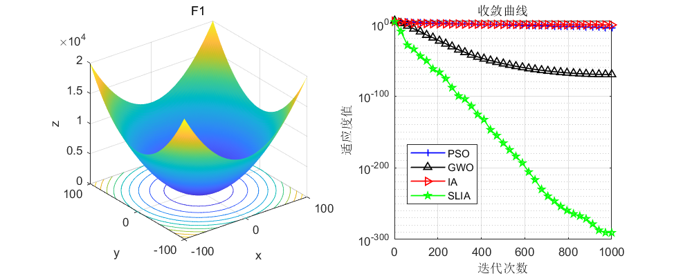
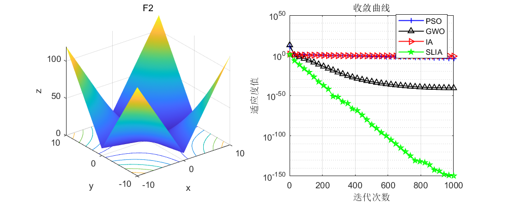
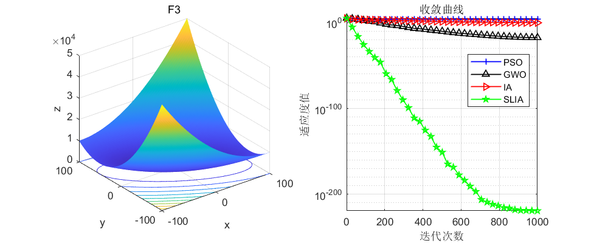
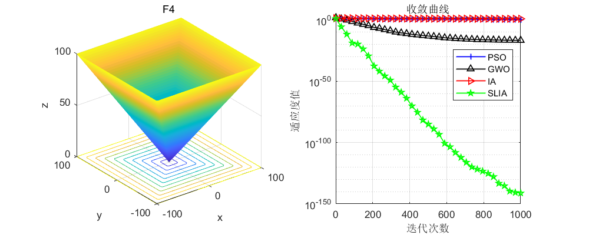
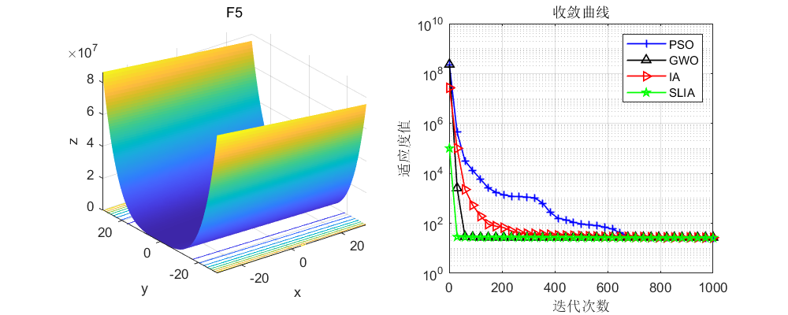
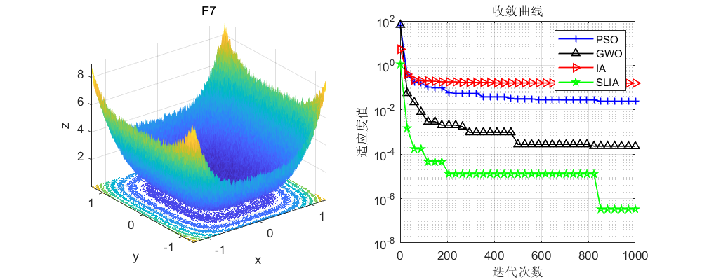
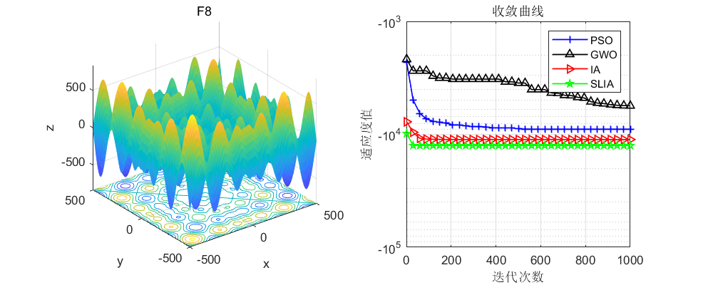
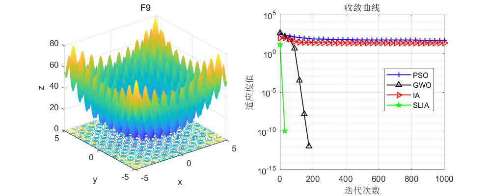
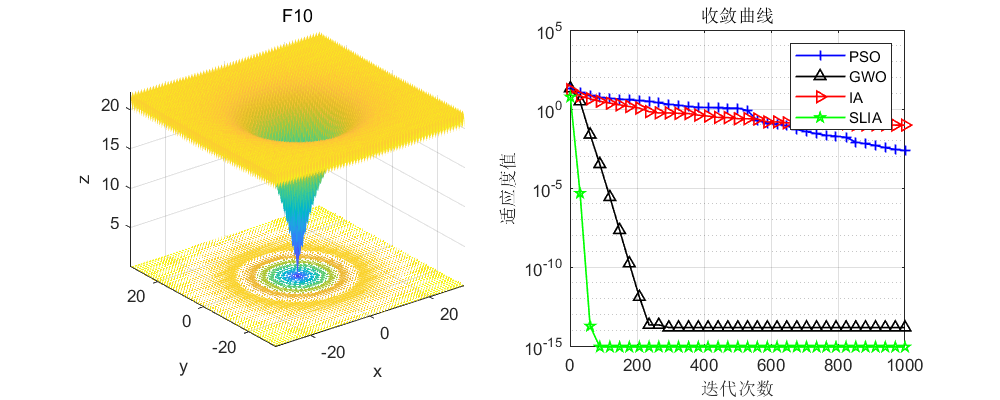

# Sinusoidal Strategy and Levy Flight-Guided Immune Algorithm (SLIA)

Immunization Algorithm Defect Analysis
① In the mutation phase, the particle update method adopted by the immune algorithm is too simple.
② In the new population generation phase, it is too random and does not consider the best value at the current iteration.
Two strategies are used to improve the immune algorithm:
① Sinusoidal Improvement Strategy: By adding the sinusoidal strategy to the original mutation algorithm, this can improve the particle's random update method and enhance the algorithm's global optimization capability.
② Levy Flight Strategy: In the new population generation phase, consider the global best value and incorporate the Levy flight formula, which allows the immune algorithm to approach the optimal value more quickly.
SLIA Results Display
The same test was conducted on the CEC2005 function set, comparing the sinusoidal strategy and the Levy flight-guided immune algorithm (SLIA) with four other optimization algorithms: Grey Wolf Optimization (GWO), Particle Swarm Optimization (PSO), and Immune Algorithm (IA). The experimental results are as follows:
Code Exhibition
%% \nclear all \nclose all\nclc\n\nN=50; % Number of search agents\n\nFunction_name='F10'; % Name of the test function, range from F1-F23\niter=1000; % Maximum number of iteration times\n\n% Load details of the selected benchmark function\n[lb,ub,dim,fobj]=CEC2005(Function_name);\n\n%% GWO\n[GWO_fMin , GWO_bestX,GWO_Convergence_curve ] =GWO(N,iter,lb,ub,dim,fobj);\ndisplay(['The best optimal value of the objective funciton found by GWO  for ' [num2str(Function_name)],'  is : ', num2str(GWO_fMin)]);\nfprintf ('Best solution obtained by GWO: %s\n', num2str(GWO_bestX,'%e  '));\n%% PSO\n[PSO_fMin , PSO_bestX,PSO_Convergence_curve ] =PSO(N,iter,lb,ub,dim,fobj);\ndisplay(['The best optimal value of the objective funciton found by PSO  for ' [num2str(Function_name)],'  is : ', num2str(PSO_fMin)]);\nfprintf ('Best solution obtained by PSO: %s\n', num2str(PSO_bestX,'%e  '));\n%% IA\n[fMin , bestX,IA_Convergence_curve ] =IA(N,iter,lb,ub,dim,fobj);\ndisplay(['The best optimal value of the objective funciton found by IA  for ' [num2str(Function_name)],'  is : ', num2str(fMin)]);\nfprintf ('Best solution obtained by IA: %s\n', num2str(bestX','%e  '));\n%% SLIA\n[SLIA_fMin , SLIA_bestX,SLIA_Convergence_curve ] =SLIA(N,iter,lb,ub,dim,fobj);\ndisplay(['The best optimal value of the objective funciton found by SLIA  for ' [num2str(Function_name)],'  is : ', num2str(SLIA_fMin)]);\nfprintf ('Best solution obtained by SLIA: %s\n', num2str(SLIA_bestX','%e  '));\n\n %% Figure\nfigure1 = figure('Color',[1 1 1]);\nG1=subplot(1,2,1,'Parent',figure1);\nfunc_plot(Function_name)\ntitle(Function_name)\nxlabel('x')\nylabel('y')\nzlabel('z')\nsubplot(1,2,2)\nG2=subplot(1,2,2,'Parent',figure1);\nCNT=35;\nk=round(linspace(1,iter,CNT)); % Randomly select CNT points\n% Note: If the number of points drawn on the convergence curve is small, and the random points are sparse, it indicates that the number of points has been insufficient. At this time, the number of points should be increased gradually, such as 100, 200, 300, etc.\n% Conversely, if the random points on the convergence curve are very dense, it indicates that too many points have been taken. In this case, the number of points should be reduced.\niter=1:1:iter;\nsemilogy(iter(k),PSO_Convergence_curve(k),'b-+','linewidth',1);\nhold on\nsemilogy(iter(k),GWO_Convergence_curve(k),'k-^','linewidth',1);\nhold on\nsemilogy(iter(k),IA_Convergence_curve(k),'r->','linewidth',1);\nhold on\nsemilogy(iter(k),SLIA_Convergence_curve(k),'g-p','linewidth',1);\n\ngrid on;\ntitle('Converging curve')\nxlabel('Iteration count');\nylabel('Fitness value');\nbox on\nlegend('PSO','GWO','IA','SLIA')\nset (gcf,'position', [300,300,800,320])\n  

## Images

<!-- PAYMENT_BLOCK -->

## Get this dataset

- Payment link (Stripe): [Buy now](https://buy.stripe.com/3cs8yP7sY87d0vu9AB)
- Payment QR code: 

<!-- /PAYMENT_BLOCK -->
